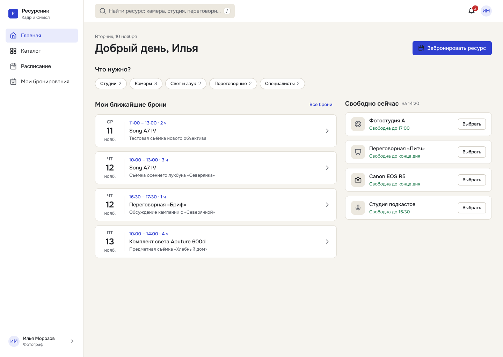

# Галерея проекта «Ресурсник»

Изображения экспортированы из Figma без элементов редактора. Все имена PNG оставлены такими, как при экспорте (кроме уже названного `desktop-home.png`).

## Десктопные экраны

| Экран | Экран |
|---|---|
| **Д-01 — Главная** | **Д-02 — Каталог ресурсов** |
|  |  |
| **Д-03 (ред. 2) — Календарь и форма бронирования** | **Д-03б — Конфликт и альтернативные слоты** |
|  |  |
| **Д-03в — Подтверждение брони** | **Д-07 — Расписание ресурсов** |
|  |  |
| **Д-10 — Безопасное удаление ресурса** |  |
|  |  |

## Мобильные экраны

| Экран | Экран |
|---|---|
| **М-02 — Каталог и фильтры** | **М-04 — Мобильная форма бронирования** |
|  |  |
| **М-05 — Разрешение конфликта на телефоне** |  |
|  |  |

## Дизайн-система

Нажатие на изображение открывает оригинальный PNG. Полный редактируемый файл доступен по [ссылке на Figma](../README.md#ссылка-на-проект-в-figma).
